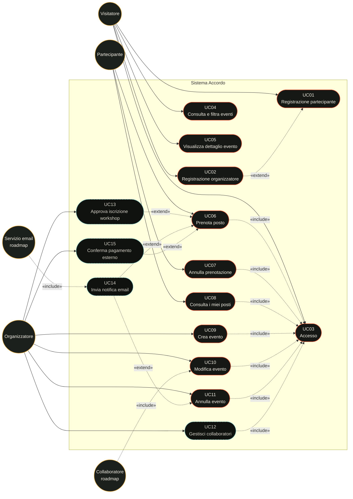

# 03 — Casi d'uso

> I casi d'uso descrivono il **dominio completo** della tesina. Quelli marcati `roadmap` sono progettati ma non implementati nell'MVP; il confine è esplicitato nella legenda e nella matrice finale.

## 1. Attori

| Attore | Tipo | Descrizione |
| --- | --- | --- |
| **Visitatore** | Primario | Persona non autenticata che consulta il catalogo e può registrarsi o accedere. |
| **Partecipante** | Primario | Utente autenticato che prenota, consulta e annulla le proprie prenotazioni. |
| **Organizzatore** | Primario | Utente autenticato che crea e gestisce i propri eventi. |
| **Collaboratore** *(roadmap)* | Primario | Utente con permessi limitati su un evento assegnato. |
| **Servizio email** *(roadmap)* | Secondario | Sistema esterno che riceve e recapita le notifiche transazionali. |

## 2. Diagramma dei casi d'uso

**Legenda:** linea continua = associazione attore/caso d'uso; `«include»` = comportamento obbligatorio riusato; `«extend»` = comportamento opzionale o condizionale; nodi tratteggiati = estensione progettata, non attiva nell'MVP.

## 3. Dettaglio dei casi d'uso

### UC01 — Registrazione partecipante

| Campo | Valore |
| --- | --- |
| **Attore** | Visitatore |
| **Precondizioni** | Nessuna; l'email non deve essere già registrata. |
| **Trigger** | Il visitatore apre “Registrati”. |
| **Flusso principale** | 1. Inserisce nome, email, password e conferma. 2. Il client valida i campi. 3. L'API normalizza l'email e verifica l'unicità. 4. Hasha la password con bcrypt. 5. Crea l'utente `PARTECIPANTE`. 6. Restituisce profilo e JWT. 7. Il client apre “I miei posti”. |
| **Flussi alternativi** | 3a. Email già presente → `409 EMAIL_IN_USE`, nessun account creato. 2a. Password corta o email non valida → errore di campo, nessuna chiamata. |
| **Postcondizioni** | Utente creato e autenticato. |
| **Requisiti / US** | RF01 · US01 |

### UC02 — Registrazione organizzatore

| Campo | Valore |
| --- | --- |
| **Attore** | Visitatore |
| **Precondizioni** | Possiede il codice invito valido. |
| **Trigger** | Seleziona “Registrati come organizzatore”. |
| **Flusso principale** | Come UC01, più la verifica del codice lato API; il ruolo assegnato è `ORGANIZZATORE`. |
| **Flussi alternativi** | Codice errato → `403 INVALID_INVITE_CODE`; codice assente → viene creato un partecipante. |
| **Postcondizioni** | Utente organizzatore creato e autenticato. |
| **Requisiti / US** | RF02 · US02 · estende UC01 |

### UC03 — Accesso

| Campo | Valore |
| --- | --- |
| **Attore** | Visitatore, partecipante, organizzatore |
| **Precondizioni** | Account esistente e attivo. |
| **Trigger** | Apre “Accedi” o tenta un'azione protetta. |
| **Flusso principale** | 1. Inserisce email e password. 2. L'API cerca l'utente per email normalizzata. 3. Confronta l'hash bcrypt. 4. Emette un JWT con `sub`, ruolo e scadenza. 5. Il client conserva il token e applica il redirect interno richiesto. |
| **Flussi alternativi** | Credenziali errate → `401 INVALID_CREDENTIALS` con messaggio generico. Token assente su rotta protetta → `401 UNAUTHENTICATED`; token scaduto o non valido → `401 INVALID_TOKEN`. Ruolo insufficiente → `403 FORBIDDEN`. |
| **Postcondizioni** | Sessione attiva lato client; nessuno stato di sessione lato server (JWT stateless). |
| **Requisiti / US** | RF03 · US03 |

### UC04 — Consulta e filtra eventi

| Campo | Valore |
| --- | --- |
| **Attore** | Visitatore, partecipante, organizzatore |
| **Precondizioni** | Nessuna. |
| **Trigger** | Apre la home o modifica un filtro. |
| **Flusso principale** | 1. Il client richiede `GET /events` con `period=upcoming`. 2. L'API filtra gli eventi `PUBBLICATO`. 3. Applica ricerca testuale, tipo, intervallo date e disponibilità. 4. Aggrega prenotazioni confermate e calcola i posti liberi. 5. Restituisce lista paginata ordinata per data. 6. La UI mostra card e conteggi. |
| **Flussi alternativi** | Nessun risultato → stato vuoto con azzeramento filtri. Errore di rete → alert con “Riprova”. |
| **Postcondizioni** | Catalogo aggiornato; nessuna modifica ai dati. |
| **Requisiti / US** | RF04 · US04 |

### UC05 — Visualizza dettaglio evento

| Campo | Valore |
| --- | --- |
| **Attore** | Visitatore, partecipante, organizzatore |
| **Precondizioni** | L'evento esiste. |
| **Trigger** | Apre una card o un link diretto. |
| **Flusso principale** | 1. `GET /events/{id}`. 2. L'API restituisce evento, organizzatore, capienza, prenotati e disponibilità. 3. Se autenticato, il client recupera anche le prenotazioni dell'utente. 4. La UI calcola lo stato del CTA: prenota, accedi, già prenotato, esaurito, concluso, annullato. |
| **Flussi alternativi** | ID malformato o inesistente → `404` e pagina “Evento non trovato”. |
| **Postcondizioni** | Nessuna modifica ai dati. |
| **Requisiti / US** | RF05 · US04 |

### UC06 — Prenota posto

| Campo | Valore |
| --- | --- |
| **Attore** | Partecipante |
| **Precondizioni** | Autenticato; evento pubblicato, futuro e con posto libero; nessuna prenotazione attiva dell'utente per l'evento. |
| **Trigger** | Preme “Prenota il posto”. |
| **Flusso principale** | 1. `POST /events/{id}/bookings` con JWT. 2. Il servizio apre una transazione. 3. Blocca la riga evento con `FOR UPDATE`. 4. Verifica stato e data. 5. Verifica assenza di prenotazione attiva. 6. Conta le prenotazioni confermate e confronta con la capienza. 7. Se concerto, cerca il primo posto libero. 8. Inserisce la prenotazione `CONFERMATA`. 9. Commit e risposta `201` con posto. 10. UI aggiorna disponibilità e mostra conferma. |
| **Flussi alternativi** | Evento annullato → `409 EVENT_CANCELLED`. Evento iniziato → `409 EVENT_STARTED`. Già prenotato → `409 ALREADY_BOOKED`. Capienza piena o nessun posto → `409 SOLD_OUT`. Utente non autenticato → redirect al login, nessuna prenotazione. |
| **Postcondizioni** | Prenotazione attiva creata; disponibilità decrementata; posto numerato occupato (solo concerti). |
| **Requisiti / US** | RF06 · US05 · include UC03 · esteso da UC13, UC14 e UC15 (roadmap) |

### UC07 — Annulla prenotazione

| Campo | Valore |
| --- | --- |
| **Attore** | Partecipante (o organizzatore dell'evento) |
| **Precondizioni** | Prenotazione `CONFERMATA`; evento non ancora iniziato. |
| **Trigger** | “Annulla” nell'area personale, con conferma. |
| **Flusso principale** | 1. `DELETE /bookings/{id}`. 2. Il servizio blocca la prenotazione. 3. Verifica ownership o ruolo organizzatore dell'evento. 4. Verifica stato e data. 5. Aggiorna a `ANNULLATA` con `cancelled_at`. 6. Commit. 7. UI sposta la riga tra “Passati e annullati”. |
| **Flussi alternativi** | Non proprietario → `403 FORBIDDEN`. Già annullata → `409 ALREADY_CANCELLED`. Evento iniziato → `409 EVENT_STARTED`. |
| **Postcondizioni** | Posto liberato e riassegnabile; storico conservato. |
| **Requisiti / US** | RF07 · US06 · include UC03 |

### UC08 — Consulta i miei posti

| Campo | Valore |
| --- | --- |
| **Attore** | Partecipante, organizzatore |
| **Precondizioni** | Autenticato. |
| **Trigger** | Apre “I miei posti”. |
| **Flusso principale** | 1. `GET /bookings/me`. 2. L'API restituisce prenotazioni con dati sintetici dell'evento. 3. La UI separa “In arrivo” e “Passati e annullati”. 4. Mostra posto, stato prenotazione e stato evento. |
| **Flussi alternativi** | Nessuna prenotazione → stato vuoto con link al catalogo. Token scaduto → login. |
| **Postcondizioni** | Nessuna modifica ai dati. |
| **Requisiti / US** | RF08 · US07 · include UC03 |

### UC09 — Crea evento

| Campo | Valore |
| --- | --- |
| **Attore** | Organizzatore |
| **Precondizioni** | Autenticato con ruolo `ORGANIZZATORE`. |
| **Trigger** | “Nuovo evento”. |
| **Flusso principale** | 1. Compila titolo, descrizione, tipo, data futura, luogo, capienza. 2. Il client valida e mostra l'anteprima. 3. `POST /events`. 4. L'API valida con Zod e imposta `created_by` dal token. 5. Inserisce l'evento `PUBBLICATO`. 6. Restituisce il DTO e la UI torna alla dashboard. |
| **Flussi alternativi** | Ruolo errato → `403 FORBIDDEN`. Dati non validi → `422 VALIDATION_ERROR` con dettagli per campo. Data passata → errore di validazione. |
| **Postcondizioni** | Evento pubblicato e visibile nel catalogo. |
| **Requisiti / US** | RF09 · US08 · include UC03 |

### UC10 — Modifica evento

| Campo | Valore |
| --- | --- |
| **Attore** | Organizzatore proprietario (roadmap: collaboratore con permesso `EDIT`) |
| **Precondizioni** | Evento esistente e non annullato; utente proprietario. |
| **Trigger** | “Modifica” dalla dashboard. |
| **Flusso principale** | 1. Il form carica l'evento. 2. L'utente aggiorna i campi. 3. `PUT /events/{id}`. 4. L'API verifica ownership e stato. 5. Se la capienza cambia, confronta con le prenotazioni attive. 6. Aggiorna e restituisce il DTO. |
| **Flussi alternativi** | Non proprietario → `403 FORBIDDEN`. Evento annullato → `409 EVENT_CANCELLED`. Capienza inferiore ai prenotati → `409 CAPACITY_TOO_LOW`. Nessun campo → `422 VALIDATION_ERROR`. |
| **Postcondizioni** | Evento aggiornato; catalogo e dettaglio riflettono le modifiche. |
| **Requisiti / US** | RF10 · US09 · include UC03 · incluso da UC12 (roadmap) |

### UC11 — Annulla evento

| Campo | Valore |
| --- | --- |
| **Attore** | Organizzatore proprietario |
| **Precondizioni** | Evento esistente, pubblicato e non già annullato. |
| **Trigger** | “Annulla evento” con conferma. |
| **Flusso principale** | 1. `POST /events/{id}/cancel`. 2. Transazione con lock dell'evento. 3. Verifica ownership e stato. 4. Evento → `ANNULLATO`. 5. Prenotazioni attive → `ANNULLATA` con timestamp. 6. Commit e risposta con `cancelledBookings`. 7. UI aggiorna la dashboard e mostra il conteggio. |
| **Flussi alternativi** | Non proprietario → `403 FORBIDDEN`. Già annullato → `409 ALREADY_CANCELLED`. |
| **Postcondizioni** | Evento fuori dal catalogo; prenotazioni chiuse; storico conservato. |
| **Requisiti / US** | RF10 · US09 · include UC03 · esteso da UC14 (roadmap) |

### UC12 — Gestisci collaboratori *(roadmap)*

| Campo | Valore |
| --- | --- |
| **Attore** | Organizzatore proprietario |
| **Precondizioni** | Evento esistente; utente proprietario. |
| **Trigger** | “Collaboratori” nella dashboard. |
| **Flusso principale** | 1. Invita un utente per email. 2. Assegna permesso `EDIT` o `MANAGE_BOOKINGS`. 3. Il sistema crea il legame evento-utente. 4. Il collaboratore vede solo gli eventi assegnati. 5. Il proprietario può revocare il permesso. |
| **Flussi alternativi** | Utente inesistente → invito pendente o errore. Permesso insufficiente → `403`. Evento annullato → nessuna modifica. |
| **Postcondizioni** | Permessi aggiornati; audit del proprietario conservato. |
| **Requisiti / US** | RF11 · US10 · include UC03 e UC10 |

### UC13 — Approva iscrizione workshop *(roadmap)*

| Campo | Valore |
| --- | --- |
| **Attore** | Organizzatore |
| **Precondizioni** | Workshop con richieste `IN_ATTESA`; capienza disponibile per l'approvazione. |
| **Trigger** | L'organizzatore apre la lista richieste. |
| **Flusso principale** | 1. La richiesta nasce `IN_ATTESA` da UC06. 2. L'organizzatore approva. 3. Il sistema verifica la capienza nella stessa transazione. 4. La prenotazione diventa `CONFERMATA`. 5. Parte la notifica email. |
| **Flussi alternativi** | Capienza esaurita → `409 SOLD_OUT`, richiesta ancora in attesa. Rifiuto → `RIFIUTATA`, posto liberato, email di esito. |
| **Postcondizioni** | Stato della richiesta aggiornato e partecipante notificato. |
| **Requisiti / US** | RF12a, RF12c · US11 · estende UC06 |

### UC14 — Invia notifica email *(roadmap)*

| Campo | Valore |
| --- | --- |
| **Attore** | Servizio email (secondario) |
| **Precondizioni** | Evento di dominio rilevante: prenotazione confermata, prenotazione annullata, evento annullato, esito workshop. |
| **Trigger** | Transizione di stato completata con successo. |
| **Flusso principale** | 1. Il servizio compone il messaggio. 2. Accoda l'invio. 3. Un worker invia via SMTP. 4. Registra esito e tentativi. 5. In locale Mailpit mostra il messaggio. |
| **Flussi alternativi** | SMTP non raggiungibile → retry con backoff; dopo N tentativi il messaggio è marcato fallito, senza bloccare la transazione di dominio. |
| **Postcondizioni** | Email recapitata o messa in coda per retry. |
| **Requisiti / US** | RF12c · US11 · estende UC06 e UC11 |

### UC15 — Conferma pagamento esterno *(roadmap)*

| Campo | Valore |
| --- | --- |
| **Attore** | Organizzatore |
| **Precondizioni** | Prenotazione attiva per un evento a pagamento; pagamento ricevuto fuori piattaforma (bonifico, contanti, link esterno). |
| **Trigger** | L'organizzatore apre il dettaglio della prenotazione e seleziona “Conferma pagamento”. |
| **Flusso principale** | 1. Inserisce il riferimento del pagamento (es. CRO o ID transazione). 2. Il sistema valida il riferimento. 3. Il pagamento passa a `PAGATO` in una transazione separata dalla prenotazione. 4. La prenotazione resta `CONFERMATA`. 5. Parte la notifica email di ricevuta. |
| **Flussi alternativi** | Riferimento assente o duplicato → `422 VALIDATION_ERROR`, stato invariato. Prenotazione annullata → `409 EVENT_CANCELLED` o `409 ALREADY_CANCELLED`. Pagamento già confermato → `409 ALREADY_PAID`. |
| **Postcondizioni** | Pagamento tracciato e riconciliabile; storico conservato anche in caso di annullamento. |
| **Requisiti / US** | RF12b, RF12c · US11 · estende UC06 |

## 4. Matrice di tracciabilità UC ↔ US

| UC | Caso d'uso | Attore | US | Requisito | Stato |
| --- | --- | --- | --- | --- | --- |
| UC01 | Registrazione partecipante | Visitatore | US01 | RF01 | MVP |
| UC02 | Registrazione organizzatore | Visitatore | US02 | RF02 | MVP |
| UC03 | Accesso | Tutti | US03 | RF03 | MVP |
| UC04 | Consulta e filtra eventi | Tutti | US04 | RF04 | MVP |
| UC05 | Visualizza dettaglio evento | Tutti | US04 | RF05 | MVP |
| UC06 | Prenota posto | Partecipante | US05 | RF06 | MVP |
| UC07 | Annulla prenotazione | Partecipante / Organizzatore | US06 | RF07 | MVP |
| UC08 | Consulta i miei posti | Partecipante / Organizzatore | US07 | RF08 | MVP |
| UC09 | Crea evento | Organizzatore | US08 | RF09 | MVP |
| UC10 | Modifica evento | Organizzatore | US09 | RF10 | MVP |
| UC11 | Annulla evento | Organizzatore | US09 | RF10 | MVP |
| UC12 | Gestisci collaboratori | Organizzatore | US10 | RF11 | Roadmap |
| UC13 | Approva iscrizione workshop | Organizzatore | US11 | RF12a | Roadmap |
| UC14 | Invia notifica email | Servizio email | US11 | RF12c | Roadmap |
| UC15 | Conferma pagamento esterno | Organizzatore | US11 | RF12b, RF12c | Roadmap |

### 4.1 Copertura delle relazioni

| Relazione | Origine | Destinazione | Tipo |
| --- | --- | --- | --- |
| Registrazione organizzatore specializza la registrazione base | UC02 | UC01 | `extend` |
| Prenotazione richiede autenticazione | UC06 | UC03 | `include` |
| Annullamento richiede autenticazione | UC07 | UC03 | `include` |
| Area personale richiede autenticazione | UC08 | UC03 | `include` |
| Creazione evento richiede autenticazione | UC09 | UC03 | `include` |
| Modifica evento richiede autenticazione | UC10 | UC03 | `include` |
| Annullamento evento richiede autenticazione | UC11 | UC03 | `include` |
| Collaboratori richiedono autenticazione | UC12 | UC03 | `include` |
| Approvazione workshop estende la prenotazione | UC13 | UC06 | `extend` |
| Notifica email estende prenotazione e annullamento | UC14 | UC06, UC11 | `extend` |
| Conferma del pagamento esterno estende la prenotazione | UC15 | UC06 | `extend` |
| Il collaboratore partecipa alla modifica evento | UC12 | UC10 | `include` |
