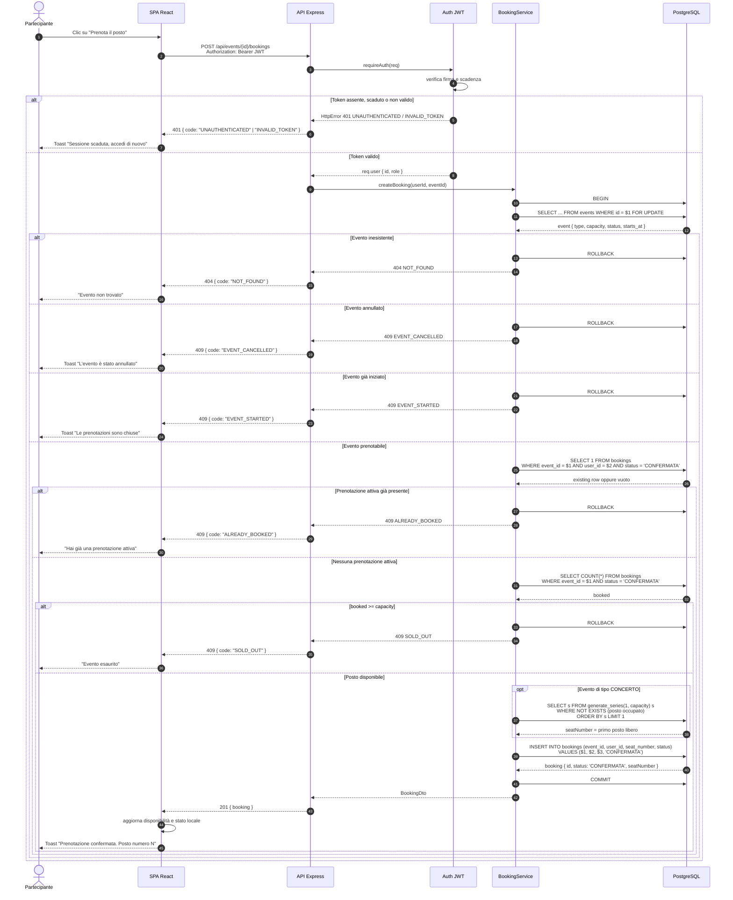
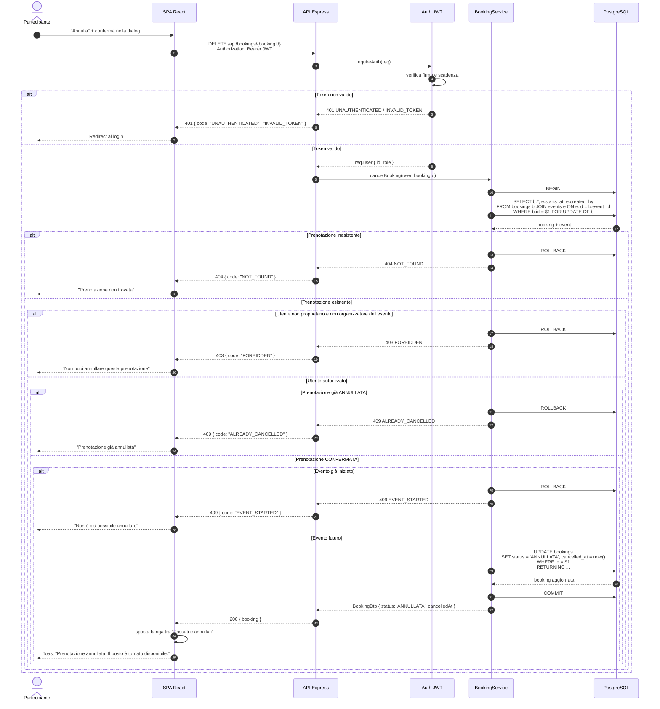
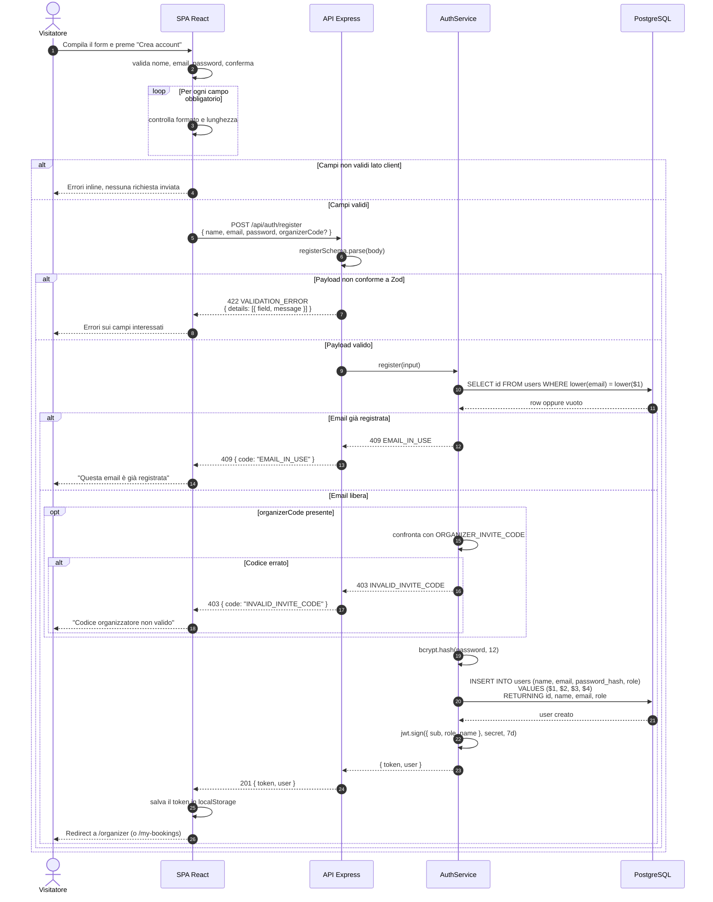

# 04 — Diagrammi di sequenza

I tre diagrammi coprono i flussi con più rischio del sistema: **prenotazione concorrente**, **annullamento con controllo di ownership** e **registrazione con codice invito**. Tutti usano `autonumber` e riportano esplicitamente i valori di ritorno; i frame `alt`, `opt` e `loop` descrivono i rami alternativi.

## 1. Prenotazione di un posto con assegnazione automatica

**Punti chiave**

- Il lock `FOR UPDATE` sulla riga evento è ciò che serializza due prenotazioni concorrenti: la seconda transazione attende il commit della prima e ricalcola il conteggio.
- Il posto viene cercato **dentro** la stessa transazione, quindi non può essere assegnato due volte.
- I vincoli univoci parziali sono la seconda linea di difesa: se un bug o una corsa sfuggisse al lock, il database rifiuterebbe comunque il duplicato con `23505 → 409`.
- Il `ROLLBACK` è esplicito in ogni ramo di errore; il client riceve sempre un payload `{ error: { code, message } }`.

## 2. Annullamento di una prenotazione

**Punti chiave**

- La cancellazione è **logica**: la riga resta e il posto torna assegnabile perché gli indici univoci considerano solo `status = 'CONFERMATA'`.
- L'organizzatore dell'evento può annullare una prenotazione altrui (utile per telefoni o richieste dirette), ma un organizzatore estraneo no.
- Il lock è sulla sola prenotazione (`FOR UPDATE OF b`), non sull'evento: due annullamenti dello stesso evento non si bloccano a vicenda.

## 3. Registrazione dell'organizzatore e bootstrap della sessione

**Punti chiave**

- La validazione è **difesa in profondità**: il form evita richieste inutili, ma l'API rivalida tutto con Zod e non si fida del client.
- La password non compare mai nelle risposte né nei log; viene hashata prima dell'insert.
- Il ruolo è determinato **solo** dal codice invito verificato lato server, non da un campo `role` inviato dal client.
- Il token è stateless: il bootstrap successivo usa `GET /auth/me` per reidratare l'utente al refresh della pagina. Se il token è scaduto, il client lo rimuove e torna ospite.

## 4. Convenzioni comuni

| Aspetto | Scelta |
| --- | --- |
| Autenticazione | Header `Authorization: Bearer <JWT>` su tutte le rotte protette. |
| Errori | `{ "error": { "code", "message", "details?" } }`, con `details` per la validazione. |
| Transazioni | `BEGIN` / `COMMIT` / `ROLLBACK` espliciti nei servizi di scrittura. |
| Lock | `FOR UPDATE` su evento in prenotazione e annullamento evento; `FOR UPDATE OF b` in annullamento prenotazione. |
| Idempotenza | La prenotazione è protetta da vincolo univoco; l'annullamento risponde `409` se già eseguito. |
| Timeout | `testTimeout` 30 s nella suite; le richieste HTTP non hanno timeout applicativo nel MVP. |
