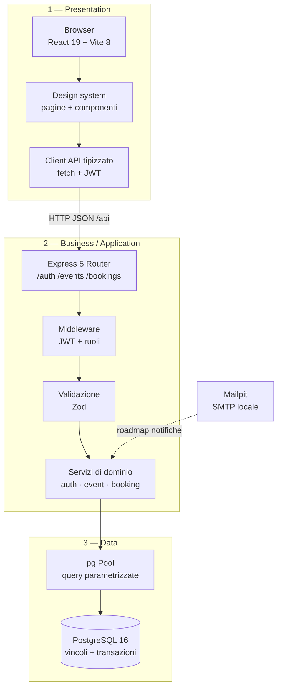
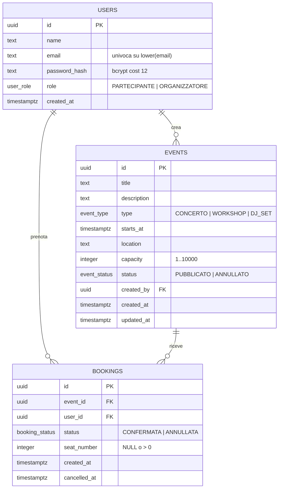
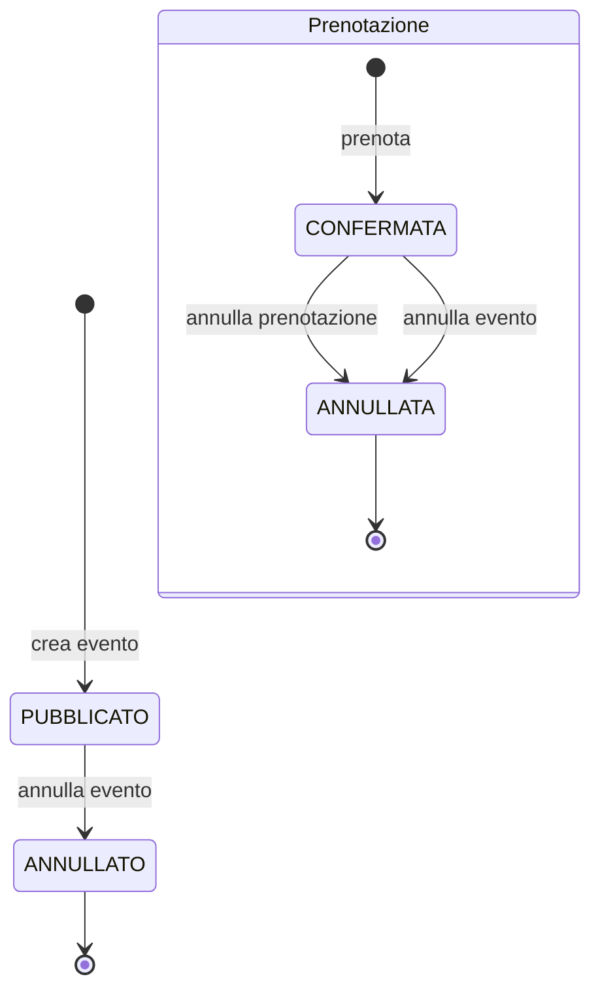
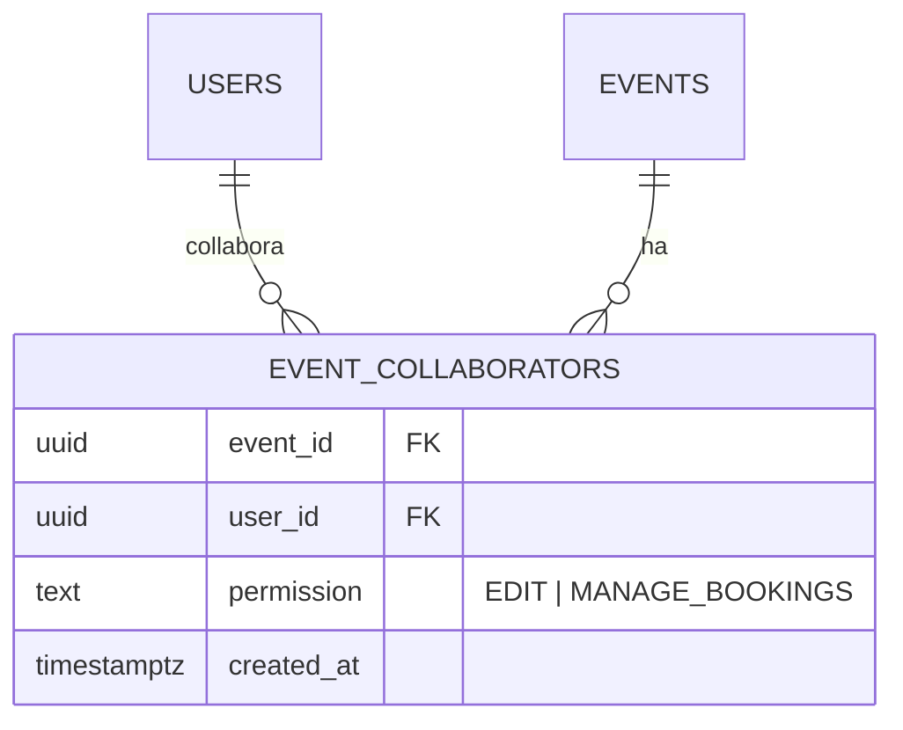
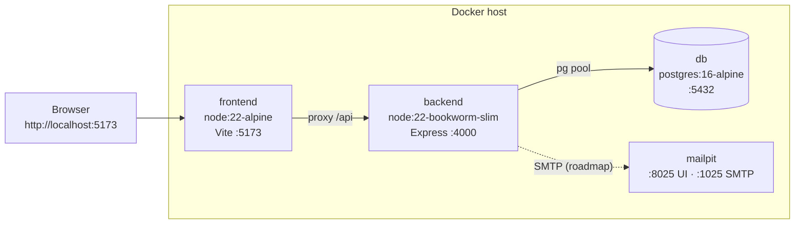

# 05 — Architettura, modello dati e API

## 1. Architettura a tre livelli



### 1.1 Presentation — React + Vite

| Componente | Responsabilità |
| --- | --- |
| `pages/` | Home, dettaglio, login, registrazione, area personale, dashboard, form evento. |
| `components/` | Layout, navbar, card, badge, modali, toast, stati vuoti, route protette. |
| `auth/AuthContext.tsx` | Bootstrap del token, login/registrazione/logout, profilo corrente. |
| `api/client.ts` | Unico punto di accesso HTTP, gestione token, normalizzazione errori. |
| `styles.css` | Design system: token colore, tipografia, griglie, responsive, reduced motion. |

**Scelte**

- **SPA e non SSR:** il prodotto è un'app autenticata con contenuti dinamici; l'indicizzazione del catalogo non è un requisito del MVP. Vite offre HMR immediato e build statica.
- **Un client API unico:** evita `fetch` sparsi, centralizza il bearer token e converte ogni errore in `ApiError` con `code`, `status` e `details`.
- **Contesto auth:** al mount chiama `GET /auth/me` se esiste un token; durante il bootstrap le pagine protette mostrano un loader invece di lampeggiare come ospiti.
- **Design system custom:** nessuna dipendenza UI pesante, pieno controllo su accessibilità e identità visiva.

### 1.2 Business — Express + TypeScript

| Componente | Responsabilità |
| --- | --- |
| `routes/` | Definizione degli endpoint, composizione di middleware e servizi. Nessuna query SQL. |
| `middleware/auth.ts` | Estrae e verifica il JWT, espone `req.user`, applica i ruoli. |
| `middleware/error-handler.ts` | Traduce `HttpError`, `ZodError` e violazioni PostgreSQL in risposte uniformi. |
| `schemas/` | Contratti di input con Zod e messaggi in italiano. |
| `services/` | Regole di dominio, ownership, transazioni, mapping DB → DTO. |
| `db/` | Pool, migrazioni idempotenti, seed demo. |
| `utils/` | JWT, errori HTTP, parsing validato. |

**Flusso di una richiesta**

1. Express riceve la richiesta e applica `express.json()`.
2. Il router seleziona l'endpoint; `requireAuth`/`requireRole` verificano il token.
3. `parseBody(schema, input)` valida e trasforma i dati; in caso di errore lancia `ZodError`.
4. Il servizio esegue la logica di dominio e le query, aprendo una transazione se scrive.
5. Il router risponde con il DTO; l'error handler centralizzato gestisce ogni eccezione.
6. Un handler 404 finale risponde `ROUTE_NOT_FOUND` per endpoint inesistenti.

**Perché i servizi e non i controller:** la logica di prenotazione è condivisa tra endpoint diversi (creazione, annullamento evento, lista organizer) e deve essere testabile senza HTTP. I router restano sottili e leggibili.

### 1.3 Data — PostgreSQL

| Elemento | Ruolo |
| --- | --- |
| `users` | Account, ruolo, hash password. |
| `events` | Eventi con capienza, stato, proprietario. |
| `bookings` | Prenotazioni con stato, posto e timestamp di annullamento. |
| `schema_migrations` | Traccia le migrazioni applicate. |
| Indici parziali univoci | Impediscono doppie prenotazioni e posti duplicati. |
| `FOR UPDATE` | Serializza il controllo di capienza e l'assegnazione del posto. |

**Perché PostgreSQL e non un database documentale:** il dominio è intrinsecamente relazionale e ha bisogno di vincoli forti (unicità condizionata, chiavi esterne, transazioni con lock). Un documento JSON avrebbe spostato questi controlli interamente nel codice, con più superficie di errore.

## 2. Modello dati

### 2.1 Schema implementato



**Vincoli e indici**

| Nome | Definizione | Scopo |
| --- | --- | --- |
| `users_email_unique` | `UNIQUE (lower(email))` | Un solo account per email, case-insensitive. |
| `events_starts_at_idx` | `(starts_at)` | Ordinamento e filtri per data. |
| `events_type_idx` | `(type)` | Filtro per formato. |
| `events_created_by_idx` | `(created_by)` | Dashboard organizzatore. |
| `bookings_event_idx` | `(event_id, status)` | Conteggio posti e lista prenotazioni. |
| `bookings_user_idx` | `(user_id, status)` | Area personale. |
| `bookings_one_active_per_user` | `UNIQUE (event_id, user_id) WHERE status = 'CONFERMATA'` | Una prenotazione attiva per utente/evento. |
| `bookings_unique_seat` | `UNIQUE (event_id, seat_number) WHERE status = 'CONFERMATA' AND seat_number IS NOT NULL` | Nessun posto assegnato due volte. |

### 2.2 Transizioni di stato



Non esistono transizioni inverse: un evento annullato non torna pubblicato e una prenotazione annullata non si riattiva. Per tornare indietro si crea un nuovo evento o una nuova prenotazione, mantenendo lo storico pulito.

### 2.3 Estensioni previste (roadmap)



Per RF12 sono previsti, senza modificare le tabelle esistenti:

- `bookings.status` esteso con `IN_ATTESA` e `RIFIUTATA` (enum `booking_status`);
- campi `payment_status` e `payment_reference` su `bookings`, oppure tabella `payments` separata;
- tabella `email_outbox` per la coda con retry;
- tabella `waitlist` per la lista d'attesa.

## 3. Scelte tecnologiche e alternative

| Ambito | Scelta | Alternativa valutata | Motivazione |
| --- | --- | --- | --- |
| Database | PostgreSQL 16 | MongoDB, SQLite | Vincoli condizionati, transazioni e lock nativi; SQLite non regge la concorrenza del caso d'uso. |
| Backend | Express 5 + TypeScript | NestJS, Fastify | Express è minimale e trasparente per un progetto didattico; TypeScript dà contratti e refactoring sicuri. |
| Validazione | Zod | Joi, validator manuale | Schema e tipo TypeScript da un'unica fonte, errori strutturati per campo. |
| Frontend | React 19 + Vite | Next.js, Vue | SPA senza requisiti SEO; Vite è veloce e la build è statica. |
| Stile | CSS custom | Tailwind, MUI | Identità visiva specifica e nessun costo di configurazione. |
| Auth | JWT HS256 | Sessione cookie, OAuth | Stateless e semplice da usare con SPA; il trade-off è l'assenza di revoca immediata. |
| Hash | bcrypt cost 12 | Argon2 | Standard diffuso, disponibile in Node senza dipendenze native fragili. |
| Test | Vitest + Supertest | Jest + axios | Integrazione HTTP reale sull'app Express, setup rapido. |
| Runtime | Docker Compose | Kubernetes, processi locali | Riproducibilità con un comando, senza infrastruttura cloud. |
| Email | Mailpit locale | SendGrid, SES | Nessuna API key, UI di ispezione, identico protocollo SMTP della produzione. |

### 3.1 Trade-off dichiarati

**JWT senza revoca.** Un logout non invalida il token lato server. Nel MVP è accettabile (token 7 giorni, nessun dato sensibile oltre al profilo). In produzione servirebbe una deny-list o token di breve durata con refresh token.

**Nessun rate limiting.** Gli endpoint di autenticazione non sono protetti da throttling. È nella roadmap come requisito di hardening prima dell'esposizione pubblica.

**Email non implementate.** Mailpit è nel Compose e la configurazione SMTP esiste, ma nessun servizio invia messaggi: l'interfaccia dichiara che nel MVP non partono email.

## 4. API REST

**Base path:** `/api`
**Formato:** JSON UTF-8
**Autenticazione:** `Authorization: Bearer <JWT>` sulle rotte protette
**Date:** ISO 8601 UTC (`2026-11-08T20:00:00.000Z`)

### 4.1 Endpoint implementati

| Metodo | Endpoint | Accesso | Body / Query | Risposta | Errori principali |
| --- | --- | --- | --- | --- | --- |
| GET | `/health` | Pubblico | — | `200 { status, database, timestamp }` | `503` se il DB non risponde |
| POST | `/auth/register` | Pubblico | `{ name, email, password, organizerCode? }` | `201 { token, user }` | `409 EMAIL_IN_USE`, `403 INVALID_INVITE_CODE`, `422 VALIDATION_ERROR` |
| POST | `/auth/login` | Pubblico | `{ email, password }` | `200 { token, user }` | `401 INVALID_CREDENTIALS`, `422` |
| GET | `/auth/me` | Autenticato | — | `200 { user }` | `401 UNAUTHENTICATED / INVALID_TOKEN` |
| GET | `/events` | Pubblico | `q`, `type`, `from`, `to`, `available`, `period`, `page`, `limit` | `200 { events[], meta }` | `422 VALIDATION_ERROR` |
| GET | `/events/mine` | Organizzatore | — | `200 { events[] }` | `401`, `403` |
| GET | `/events/{id}` | Pubblico | — | `200 { event }` | `404 NOT_FOUND` |
| POST | `/events` | Organizzatore | `{ title, description?, type, startsAt, location, capacity }` | `201 { event }` | `401`, `403`, `422` |
| PUT | `/events/{id}` | Organizzatore proprietario | Campi parziali | `200 { event }` | `403 FORBIDDEN`, `404`, `409 EVENT_CANCELLED`, `409 CAPACITY_TOO_LOW`, `422` |
| POST | `/events/{id}/cancel` | Organizzatore proprietario | — | `200 { event, cancelledBookings }` | `403`, `404`, `409 ALREADY_CANCELLED` |
| GET | `/events/{id}/bookings` | Organizzatore proprietario | — | `200 { bookings[] }` | `403`, `404` |
| POST | `/events/{id}/bookings` | Autenticato | — | `201 { booking }` | `409 EVENT_CANCELLED`, `EVENT_STARTED`, `ALREADY_BOOKED`, `SOLD_OUT`, `404` |
| GET | `/bookings/me` | Autenticato | — | `200 { bookings[] }` | `401` |
| DELETE | `/bookings/{id}` | Proprietario o organizzatore dell'evento | — | `200 { booking }` | `403`, `404`, `409 ALREADY_CANCELLED`, `409 EVENT_STARTED` |

Specifica completa e schemi: [`openapi.yaml`](openapi.yaml).

### 4.2 Formato degli errori

```json
{
  "error": {
    "code": "VALIDATION_ERROR",
    "message": "Alcuni campi non sono validi.",
    "details": [
      { "field": "capacity", "message": "La capienza minima è 1." },
      { "field": "startsAt", "message": "La data dell'evento deve essere futura." }
    ]
  }
}
```

| Codice | HTTP | Quando |
| --- | --- | --- |
| `VALIDATION_ERROR` | 422 | Zod fallisce su body o query. |
| `UNAUTHENTICATED` | 401 | Header `Authorization` assente o non Bearer. |
| `INVALID_TOKEN` | 401 | Token malformato, scaduto o con firma non valida. |
| `INVALID_CREDENTIALS` | 401 | Email o password errate. |
| `FORBIDDEN` | 403 | Ruolo o ownership insufficienti. |
| `INVALID_INVITE_CODE` | 403 | Codice organizzatore errato. |
| `NOT_FOUND` | 404 | Risorsa inesistente o ID non valido. |
| `ROUTE_NOT_FOUND` | 404 | Endpoint inesistente. |
| `EMAIL_IN_USE` | 409 | Email già registrata. |
| `ALREADY_BOOKED` | 409 | Prenotazione attiva già presente. |
| `SOLD_OUT` | 409 | Capienza esaurita. |
| `EVENT_CANCELLED` | 409 | Evento annullato. |
| `EVENT_STARTED` | 409 | Evento già iniziato. |
| `ALREADY_CANCELLED` | 409 | Prenotazione o evento già annullato. |
| `CAPACITY_TOO_LOW` | 409 | Capienza inferiore ai posti prenotati. |
| `CONFLICT` | 409 | Violazione di unicità non mappata (fallback `23505`). |
| `INTERNAL_ERROR` | 500 | Errore non gestito; in development include il dettaglio. |

**Regole di progettazione**

- Il client non interpreta mai il testo del messaggio per logica: usa `code`.
- I messaggi sono in italiano e pensati per l'utente finale.
- `details` è presente solo per errori di validazione.
- Il 404 di un ID malformato è intenzionale: non si distingue “non esiste” da “formato errato”.

### 4.3 Sicurezza

| Controllo | Implementazione |
| --- | --- |
| Password | bcrypt cost 12; mai restituita. |
| Token | HS256, scadenza 7 giorni, secret da ambiente. |
| Ruoli | `requireRole('ORGANIZZATORE')` sulle rotte di gestione. |
| Ownership | Confronto `created_by === user.id` in modifica, annullamento e lista prenotazioni. |
| SQL injection | Query parametrizzate, nessuna interpolazione di input. |
| Open redirect | Il client accetta solo redirect interni che iniziano con `/` e non con `//`. |
| Segreti | `.env` escluso da Git; default solo per sviluppo. |
| CORS | Origine configurabile, default `http://localhost:5173`. |
| Errori interni | Stack e dettagli esposti solo in `NODE_ENV=development`. |

## 5. Deployment locale



| Servizio | Immagine / build | Porta | Dipendenze |
| --- | --- | --- | --- |
| `db` | `postgres:16-alpine` | 5432 | volume `db-data`, init script per `accordo_test` |
| `mailpit` | `axllent/mailpit:v1.27` | 8025, 1025 | — |
| `backend` | Dockerfile Node 22 | 4000 | db healthy; esegue migrate + seed + dev |
| `frontend` | Dockerfile Node 22 Alpine | 5173 | backend |

**Avvio:** `docker compose up -d --build`.
**Persistenza:** volume nominato per PostgreSQL; `docker compose down -v` cancella i dati.
**Riavvio:** migrazioni e seed sono idempotenti, quindi il comando non duplica nulla.

## 6. Osservabilità e qualità

| Strumento | Uso |
| --- | --- |
| `GET /api/health` | Verifica applicativa e connessione DB, usata anche dall'healthcheck del container. |
| Log backend | Errori non gestiti con stack; log di avvio e migrazioni. |
| Log frontend | Errori di rete e API mostrati all'utente con possibilità di riprovare. |
| Test di integrazione | 16 casi su database dedicato, inclusa la concorrenza. |
| Typecheck | `tsc --noEmit` su entrambi i workspace. |
| Build | `vite build` con bundle controllato. |

## 7. Limiti noti dell'architettura

1. **Nessuna coda o worker:** le email (quando arriveranno) richiederanno un outbox e un processo separato.
2. **Nessun caching:** ogni richiesta al catalogo interroga il database. Con il volume attuale è corretto; a scala servirebbe cache HTTP o materialized view per i conteggi.
3. **Nessuna revoca JWT:** vedi trade-off sopra.
4. **Nessun rate limiting:** da aggiungere prima dell'esposizione pubblica.
5. **Frontend senza test automatici:** la suite copre l'API; i flussi UI sono stati verificati manualmente con browser e viewport mobile.
